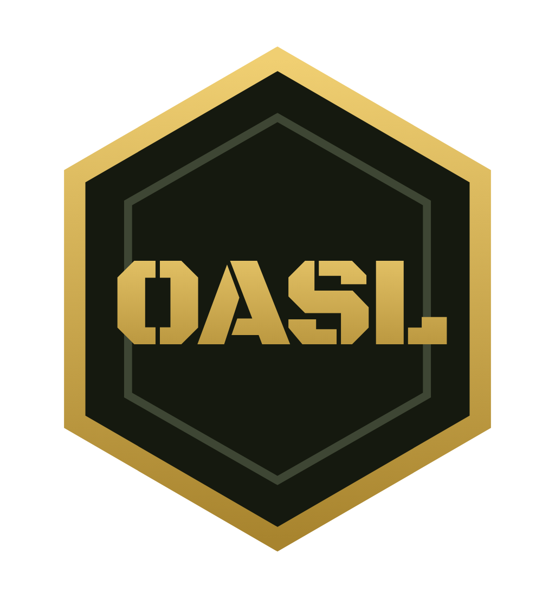
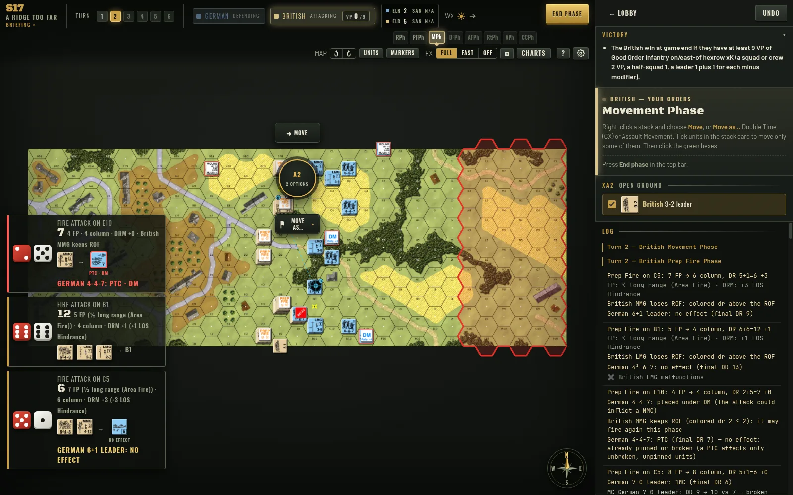
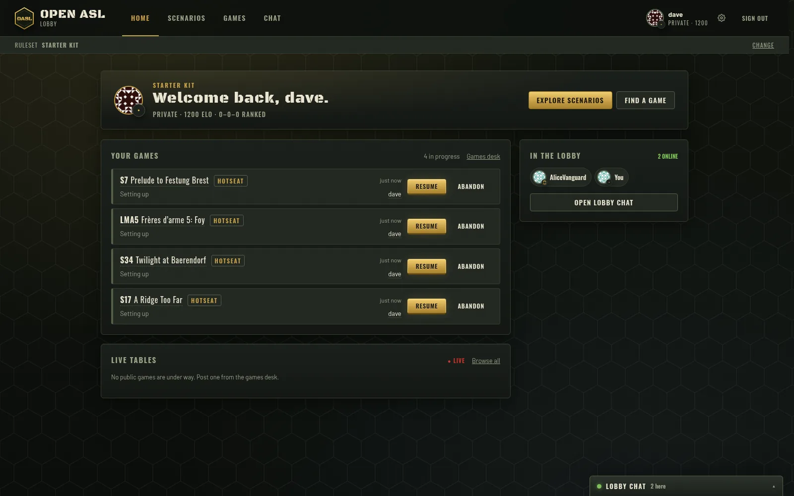
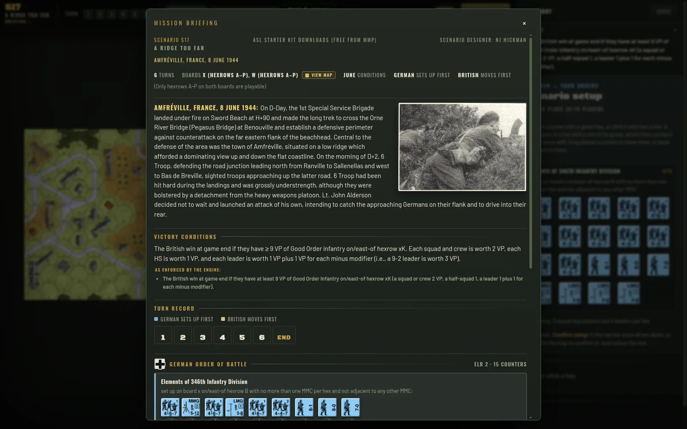
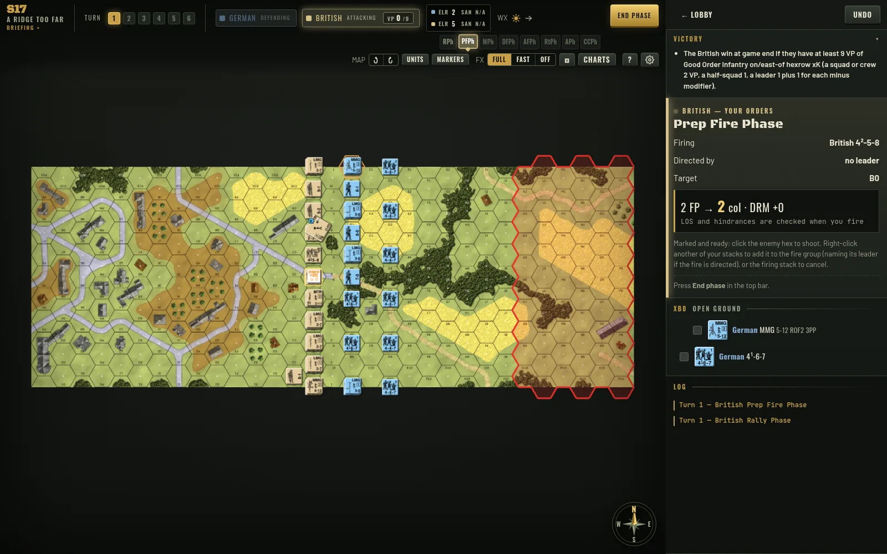
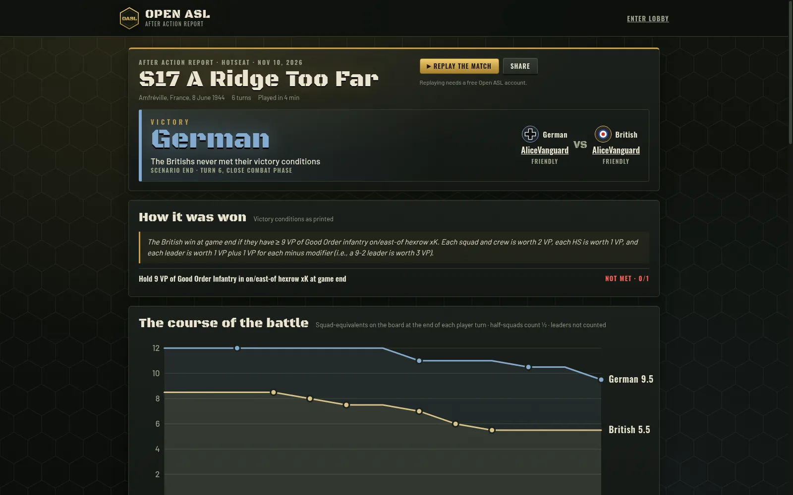

<div align="center">



# Open ASL

**Advanced Squad Leader in the browser, with every rule enforced by the engine.**

Hotseat and live online play · ASL Starter Kit rules complete · full ASL under way

[](https://github.com/Open-ASL/open-asl/actions/workflows/ci.yml)
[](LICENSE)
[](#licence)
[](docs/getting-started.md)
[](https://pnpm.io)
[](https://www.typescriptlang.org)
[](https://react.dev)
[](https://pixijs.com)
[](https://firebase.google.com/docs/emulator-suite)
[](CONTRIBUTING.md)
[](https://github.com/sponsors/Open-ASL)

**[Play online at openasl.app](https://openasl.app)** · [Discord](https://discord.gg/rNE3X32twS) · [YouTube](https://www.youtube.com/channel/UCAdltvkQODlUfHs7BmBP3GQ)



</div>

---

Open ASL is a free, non-commercial way to play **Advanced Squad Leader (ASL)** and the **ASL Starter Kit**
in a web browser. It is not a table emulator like VASL: the rules engine is the referee. It runs every
phase, rolls every die, works out line of sight, morale, rout and close combat, and only offers the moves
the rules allow. You play the game; nobody has to look anything up.

## Features

- **The engine is the referee.** Rally, Prep Fire, Movement with Defensive First Fire, Advancing Fire,
  Rout, Advance and Close Combat, all resolved by the rules, with a log that says why.
- **Starter Kit rules, complete:** infantry, support weapons, leaders and heroes; Guns and ordnance (To
  Hit, acquisition, IFE, malfunction, HIP); vehicles and armoured combat (Motion, Bounding First Fire,
  To Kill, wrecks, Bog); and the Pacific (Japanese, caves, banzai, PTO terrain).
- **Full ASL under way:** multi-level Locations, building and hill levels, LOS with heights, Bypass and
  the rest of Chapter A, built on the same engine with a coverage ledger in
  [`packages/rules/docs`](packages/rules/docs).
- **Automatic line of sight** traced on the real board art, hills, Crest Lines and all.
- **Hotseat and live online play**, server-refereed: open seats, direct challenges, clocks, timeouts,
  undo requests, spectating, lobby chat and presence.
- **No peeking, no rewind.** Online, every decision is checked on the server, and hidden units stay hidden.
- **After Action Reports** for every finished game: the story of the battle, casualties, turning points,
  luck charts and a full replay, with a shareable card.
- **Scenario atlas:** every scenario on a globe, searchable by nation, year and product.
- **Service records:** ranks, Elo, ribbons and medals.

<table>
  <tr>
    <td></td>
    <td></td>
  </tr>
  <tr>
    <td></td>
    <td></td>
  </tr>
</table>

## What is in this repository

- The complete rules engine for the ASL Starter Kit, and the full ASL rules in progress.
- The web app: the board, the lobby, hotseat and online play, After Action Reports and profiles.
- The Firebase backend (Cloud Functions, security rules) and an emulator setup, so the whole thing runs on
  your machine with no accounts and no cloud project.
- Playable scenarios: Multi-Man Publishing's **free** Starter Kit scenarios (S7, S8, S17–S19, S28–S36),
  Laurent Martin's free LMA scenarios, and Open ASL's own demo scenarios.

The scenarios sold in the Starter Kit modules are **not** included, and never will be: they are
Multi-Man Publishing's products. Buy the games, and support the people who make ASL.

## Quick start

You need Git, Node.js 22+, pnpm 10 and Java 21+ (for the Firebase emulators).

```bash
git clone https://github.com/Open-ASL/open-asl.git
cd open-asl
pnpm install
pnpm dev
```

In a second terminal, create yourself an account with `pnpm seed you@example.com`, then open
<http://localhost:5173> and sign in with that address and the password `password`. **New to this?** The [getting started guide](docs/getting-started.md) walks through installing
everything on Windows, macOS and Linux, step by step.

| Command | What it does |
| --- | --- |
| `pnpm dev` | Builds the functions and starts the emulators and the web app |
| `pnpm seed <email>...` | Creates test accounts in the emulators (password: `password`) |
| `pnpm typecheck` | Type-checks every package |
| `pnpm test` | Runs the unit tests |
| `pnpm build` | Builds everything for production |

## How it is built

| Package | What it is |
| --- | --- |
| [`packages/engine`](packages/engine) | A small, deterministic game engine: decisions, actions, events, seeded dice |
| [`packages/rules`](packages/rules) | The ASL rules: the Starter Kit (`sk1`–`sk4`) and full ASL (`asl`) |
| [`packages/content`](packages/content) | Boards, counters, terrain, line of sight, scenarios and their special rules |
| [`packages/platform`](packages/platform) | Shared types for matches, profiles, ranks, Elo and medals |
| [`packages/aar`](packages/aar) | The After Action Report builder |
| [`apps/web`](apps/web) | The React app, with the board drawn in PixiJS |
| [`functions`](functions) | Firebase Cloud Functions: the server-side referee, lobby, chat and reports |
| [`tools`](tools) | The importer for the VASL boards and counters, and the source art of the HD counters |

Every game is a seeded, replayable list of actions. The server replays the same engine to check each
online move, so the client never has to be trusted.

## Contributing

Contributions are welcome: bug reports, rules fixes, tests, features and free scenarios. Please read
[CONTRIBUTING.md](CONTRIBUTING.md) first. In short: test what you send, follow the existing look and feel,
and never submit copyrighted material such as scans of boards, counters, rules or scenario cards.

## Support Open ASL

Open ASL is free, with no ads and no paywalls. If you enjoy it, you can help pay for the servers that
referee online games, and for the time that goes into the rules, by
**[sponsoring the project on GitHub](https://github.com/sponsors/Open-ASL)**. Captains and field
promotions get their name on a leader in the game.

## Credits

The high-resolution map boards are by **Neal Ulen** ([asl-players.net](https://asl-players.net)). The
counter art and the board data come from [VASL](https://github.com/vasl-developers/vasl). The free
scenarios are credited to their designers. See [CREDITS.md](CREDITS.md) for everyone.

## Licence

Open ASL is **source-available** under the [GNU AGPL 3.0 with the Commons Clause](LICENSE). You may use,
study, modify and share it, and run it for others, but you may not sell it or anything derived from it.
Anyone who runs a modified version for others must publish their changes under the same terms. Some files
keep their own licences (the VASL-derived art is LGPL 2.1); [NOTICE.md](NOTICE.md) lists them.

## Disclaimer

Open ASL is not affiliated with, sponsored by or endorsed by Multi-Man Publishing or Hasbro. Advanced
Squad Leader and ASL are trademarks of Hasbro, Inc., used under licence by Multi-Man Publishing. Open ASL
is a non-commercial, fair-use interpretation of the ASL rules, written in its own words; it reproduces no
rulebook text.
